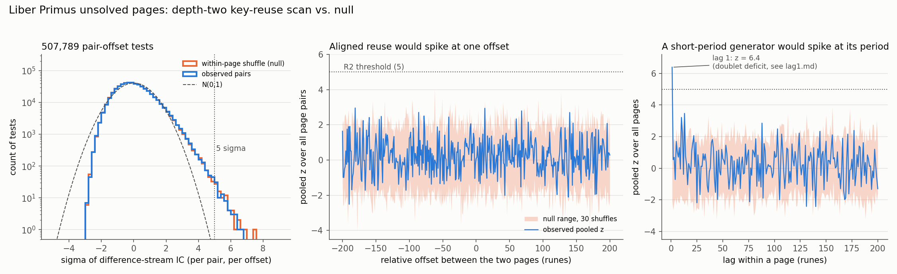

# Liber Primus (Cicada 3301): pre-registered cryptanalysis of the unsolved pages

**Status (2026-10-27).** Eight pre-registered analyses on the 56 unsolved pages, each with planted
controls, each a negative result reported as one; a three-model hypothesis loop gated on the pages'
own statistics (§17); and a ledger against the other public 2026 labs (`results/ledger_diff.md`).
The loop's remaining short-list families are swept in §19 (null); cumulative-Gematria ciphertext
feedback and the book's streams run globally with no per-page reset in §20 (null); §21 checks a
Quorum panel's claim that the remaining mechanisms are indistinguishable (they are not), and §22 sweeps
the one survivor that was still breakable, a hard rule with nulls at unknown positions (null). §23
records an external review of 2026-10-27 and what it changed: the z ≥ 6 rule reaches 80 % power
only at 92 runes under the soft rule and at 200 runes in the null lane, so exclusions on the 2 and 9
pages shorter than that are inconclusive, not negative; the decoder's rejection bound was raised;
two calibration statements were corrected. §24 runs a pre-registered secondary rule on those nine
pages over the phase 3–4 key library (null; it sees a planted soft-rule solution about nine times in
ten at these lengths and a null-lane one about two times in three, under half at 66–76 runes; the
phase 6–9 mechanisms were not carried to those pages). Nothing here is a solve. The one real structure in the ciphertext, a fivefold deficit of doubled runes,
was known to the community a decade ago; this repository's contribution is independent
replication with controls, the exclusion of every key family anyone has named for it on the pages
long enough for the detector to see a planted solution (§23), and the tooling to test the next one in
minutes. None of this shows that the key was never published; it shows that no accepted decoding
exists within the tested configurations, at the stated detection limits. Sources and pinned revisions: `SOURCES.md`. Licence: MIT.
The transcription in `data/raw/` is rtkd/iddqd's; the Latin and Old English corpora are public domain.

---

# Phase 1: is any keystream reused across the unsolved pages?

A depth-two (key-reuse) index-of-coincidence test on the 56 unsolved pages of Cicada
3301's Liber Primus, preceded by the computation that decides whether such a test can
work at all. Everything here is reproducible from `src/` with numpy; sources and pinned
revisions are in `SOURCES.md`; tables are in `results/`.

**Short answer.** The test the panel described is underpowered on single page pairs
(q − 1/29 = 0.0019, about 1.8 sigma per aligned pair of 250 runes), so I ran it anyway
and added a pooled version that sums all 1,485 pairs. Both are null for aligned reuse
at any offset within ±200 runes and for any within-page period from 2 to 200. The one
real non-randomness found is at lag 1: the unsolved pages contain 86 doubled runes
where 445 are expected (z = −17). That is a property of the cipher, not evidence of a
reused key.

## 1. Data

- Transcription: the rtkd/iddqd master file (pinned commit in `SOURCES.md`), confirmed
  rune-for-rune against Taiiwo/cicada and page-for-page against LiberPrimusSolver's
  `unsolved.txt`. The book has 74 pages; pages 1–15 and 72–73 are solved, chunks 16–71
  are the 56 unsolved LP2 pages (`LP2-00`..`LP2-55`), one of which (LP2-50) is image-only.
- Alphabet: Gematria Primus, 29 runes, index 0..28 = F U TH O R C G W H N I J EO P X S T
  B E M L NG OE D A AE Y IA EA.
- Plaintext: the solved pages were *decrypted with their published keys* (Atbash,
  Vigenère DIVINITY and FIRFUMFERENFE with the "plaintext F is left unencrypted" rule,
  shift-3-then-Atbash, the totient prime stream, and plain Gematria) and every section
  was verified rune-for-rune against the rtkd English translation. This gives 2,977
  plaintext runes in the book's own spelling (`data/processed/solved_plaintext_latin.txt`),
  avoiding the English-to-rune ambiguities (NG vs N+G, EA vs E+A, IA/IO, C/K) that a
  back-mapping would introduce. Script: `src/prepare.py`.

## 2. q and the power of the test (`src/q.py`, `results/q.md`)

With p the rune frequency vector of the plaintext, q = Σ_d (Σ_a p_a p_{(a−d) mod 29})² is
the coincidence rate of the difference of two independent plaintext streams, i.e. what
C − C' leaves behind when the keystream cancels.

| quantity | value |
|---|---|
| plaintext runes | 2,977 |
| IC of the plaintext itself | 0.0614 |
| **q** | **0.0364** (bootstrap 95% CI 0.0361–0.0368) |
| 1/29 | 0.0345 |
| **q − 1/29** | **0.0019** |
| empirical IC of page-minus-page differences, 200-rune windows | 0.0364 |

Under the null (independent iid uniform keystreams) the difference stream is iid
uniform, E[IC] = 1/29, and because pairs of positions sharing one index are uncorrelated
for a uniform alphabet, Var[IC] = 2π(1−π)/(N(N−1)) exactly (π = 1/29), i.e. sd ≈ 0.258/N.
Monte Carlo agrees to three digits.

| N | sd of IC under null (exact / MC) | sigma per aligned pair if the key is reused |
|---|---|---|
| 150 | 0.00173 / 0.00173 | 1.1 |
| 250 | 0.00103 / 0.00104 | 1.8 |
| 400 | 0.00065 / 0.00065 | 2.9 |

**Verdict on power: underpowered.** The excess is 0.0019, well under the 0.005 the panel
said it needed. A fully reused key would move a single 250-rune pair by under 2 sigma,
while the scan below makes half a million comparisons whose null maximum is 7–8 sigma.
Per-pair 5-sigma detection is therefore impossible for this plaintext distribution.

What *is* powered is pooling: if every page restarted the same generator from the same
state, all 1,485 pairs would be elevated at offset 0 and the pooled z would be about
65. If a quarter of the pages shared a stream, roughly 4 sigma pooled. So the pooled
test can still rule out the "identical reset on every page" hypothesis decisively.

## 3. The scan (`src/depth_two.py`, `results/depth_two.md`, `results/depth_two.png`)

Pre-registered before running (text in the script header):

- **R1 (panel rule, per pair):** a positive needs ≥ 3 disjoint page pairs each at or
  above 5 sigma with mutually consistent offsets.
- **R2 (pooled, added because of section 2):** pooled z(k) = Σ_pairs sigma / √(#pairs) at
  each offset k and each within-page lag L; a positive needs z ≥ 5 *and* above the
  maximum seen in every within-page permutation replicate (runes shuffled inside each
  page, which keeps every page's rune frequencies so a non-flat ciphertext cannot fake
  a positive).

Setup: 55 pages with runes, 1,485 pairs, offsets −200..+200, lags 1..200, minimum
overlap 60 runes; 507,789 pair-offset tests and 9,376 page-lag tests; 30 permutation
replicates of the whole scan.



**Per pair (R1).** Top 20 hits are in `results/depth_two.md`. The strongest is
LP2-38/LP2-49 at offset −41, 6.63 sigma, on an overlap of only 66 runes. There are 74
hits at or above 5 sigma, at 68 distinct offsets, the most repeated offset having 3.
The shuffled-page null gives 58–87 such hits per replicate (median 70), and the observed
maximum 6.63 is *below* every one of the 30 null maxima (6.65–8.11). The histogram of
observed sigmas lies on top of the null's. R1 does not trigger once calibrated; read
literally ("some pair ≥ 5 sigma") it would trigger on shuffled data just as often.

A post-hoc note for honesty: three hits sit at |offset| ≤ 1 (LP2-28/42 at 0, LP2-04/45
at +1, LP2-35/38 at −1) where about 0.55 are expected, a ~2% coincidence after the fact.
Their difference-stream ICs (0.040) are also about 4 sigma *above* what a reused key
predicts (q = 0.0364), and the pooled z at offset 0 over all pairs is 0.08. I do not
count them as evidence.

**Pooled (R2), cross-page offsets.** Pooled z at offset 0 is 0.08 (null: 0.16 ± 0.89).
The largest pooled z over all 401 offsets is 2.96 (offset −181) against a null maximum of
2.99 ± 0.37 (max 4.07). Null. Nothing resembling the ~65 an identical reset would give,
nor the ~4 a quarter-sized shared subset would give.

**Pooled (R2), within-page lags.** The largest pooled z is 6.39 at **lag 1**, above the
null maximum 3.87, so R2 triggers there. Lags 2–200 are null (next largest 3.47 at lag 13,
3.21 at lag 10, both inside the null range). `src/lag1.py` shows what lag 1 is: of 12,901
adjacent rune pairs, only **86 are doublets (same rune twice) against 445 expected,
z = −17.3**; a few other difference classes are mildly over-represented (d = 20, 27, 16,
19 at +2.5 to +3.1). This is a deficit of repeats spread across pages (5 pages above +2
sigma, none below −2, mean +0.86), not a short-period generator: a period-1 generator
means a constant key, which would make every page's lag-1 structure that of plaintext
(lag-1 IC 0.0388) and give a pooled z near 29, not 6.4. The doublet deficit in the
unsolved pages is, to my knowledge, already known in the Cicada community; here it is
simply the only thing in the ciphertext that is not consistent with iid uniform
keystreams. It also explains the one other oddity in the tables: the mean sigma over all
pair-offset tests is +0.0065 (null ≈ 0), the same at every offset. Adjacent index pairs
are 2/N of all pairs, and two pages sharing the same non-uniform lag-1 difference
distribution match on those with an excess of about 9 × 10⁻⁴, which predicts a mean
sigma of about +0.007. Offset-independent, so unrelated to aligned reuse.

## 4. Decision

- Aligned keystream reuse between any two unsolved pages at any offset in ±200 runes:
  **not detected**; the pooled test excludes a shared reset generator across all or a
  large fraction of pages, and the per-pair test could not have seen a single reused
  pair anyway (section 2).
- Within-page periodic keystream with period 2–200: **not detected**.
- Lag 1: a real, strong deficit of doubled runes; a cipher property, not key reuse.
- A null here rules out aligned reuse at the tested offsets and short-period resets
  only. It says nothing about a long-period generator, about reuse at offsets beyond
  200, about autokey or transposition schemes, or about whether the pages are stream
  ciphers at all.

## 5. For the debate

My take: the depth-two test cannot settle this. I computed q from the 2,977 runes of
verified Liber Primus plaintext and got 0.0364, only 0.0019 above 1/29, so even a page
pair that shared its entire keystream would show up at under 2 sigma, while the scan
needs to survive half a million comparisons whose chance maximum is 7 to 8 sigma. I ran
it anyway over all 1,485 pairs of unsolved pages at every offset within ±200 and every
within-page lag up to 200: the per-pair hits are exactly what shuffled pages produce, the
pooled signal at offset 0 is zero against a prediction of about 65 if every page reset the
same generator, and no offset or lag from 2 to 200 stands out. The only real structure is
that the unsolved pages almost never repeat a rune twice in a row (86 doublets where
445 are expected, 17 sigma), which is a property of the cipher and not a reused key. So
aligned key reuse and short-period page resets are off the table; everything else,
including a long-period stream or a non-stream cipher, is untouched by this test.

## Reproduce

```
python3 -m venv .venv && .venv/bin/pip install numpy matplotlib
.venv/bin/python -I src/prepare.py      # decrypt + verify solved pages -> data/processed/
.venv/bin/python -I src/q.py            # results/q.md, q.json
.venv/bin/python -I src/depth_two.py 30 # results/depth_two.md, *.npz, summary.json (~3 min)
.venv/bin/python -I src/lag1.py         # results/lag1.md
.venv/bin/python -I src/plot.py         # results/depth_two.png
.venv/bin/python -I src/word_lag.py     # results/word_lag.md (phase 7 lane: src/skip2_lane.py, ~11 min)
```

Layout: `data/raw/` downloaded sources (never executed), `data/processed/` verified
pages, `src/` scripts (`lp.py` holds the alphabet and parsers), `results/` outputs.

---

# Phase 2: the doublet deficit, which ciphers produce it, and a better reuse detector

Phase 1 left one real signature in the unsolved pages, a shortage of doubled runes, and one
weak test. Phase 2 asks whether the signature is real, what makes it, and whether a better
scorer changes the key-reuse verdict. Scripts: `src/doublet_audit.py`, `src/doublets.py`,
`src/diff_score.py`; tables in `results/`.

## 4. Is the doublet deficit cipher structure? (`results/doublet_audit.md`)

Doublet = the same rune twice in a row. Two nulls: iid uniform (rate 1/29 = 0.0345) and a
within-page shuffle that keeps each page's rune frequencies.

| text | adjacent pairs | doublets | rate | z vs uniform | z vs shuffle |
|---|---|---|---|---|---|
| solved plaintext (decrypted with the published keys) | 2,968 | 77 | 0.0259 | −2.5 | −8.6 |
| solved ciphertext (as transcribed) | 2,960 | 75 | 0.0253 | −2.7 | −7.2 |
| **unsolved ciphertext** | 12,901 | **86** | **0.0067** | **−17.3** | **−17.1** |

- The plaintext has the mild deficit ordinary English has (letters repeat less than
  independence predicts), nothing like fivefold.
- The solved *encrypted* pages sit at the uniform rate page by page (Atbash, both Vigenères,
  the totient stream: z between −1.6 and −0.1); the "plain" unencrypted pages inherit the
  plaintext's mild deficit, which is what pulls the solved-ciphertext row slightly below uniform.
- The transcription drops word, line and paragraph separators identically for the observed
  pages and the shuffle, and writes doubled letters as two runes. Inside words the unsolved
  rate is 0.0062; across separators 0.0080. Same deficit either side of a boundary, so it is
  not a word-level writing rule.
- Ciphertext autokey at lags 1 to 5 decrypts the pages to a flat stream with one hole where F
  would be (IC 0.0353, nothing like plaintext's 0.0614), so the simplest feedback cipher is out.

**The deficit is cipher structure.** Whatever generates these pages makes each rune avoid the
previous one about four times out of five more often than an additive cipher with an
independent, uniform key can.

## 5. Which constructions reproduce it? (`results/doublets.md`)

Twenty constructions encipher resampled solved-page plaintext cut into the 55 real page
lengths, 200 replicates each, and are scored on the pages' four statistics: doublets (86),
non-uniformity of the other lag-1 difference classes (chi² 42 on 27 dof), unigram flatness
(chi² 26 on 28 dof) and IC (0.0345).

| family | doublets | verdict |
|---|---|---|
| independent key with uniform differences: iid uniform, running key from English, hand pad with no repeated key symbol, the book's own Vigenère and totient streams | 430–506 | ruled out: a key with uniform successive differences hits a doublet one time in 29 (independence alone is not enough; a constant key keeps every plaintext doublet) |
| plaintext autokey, lags 1–5 | 481–698 | ruled out, and leaves heavy lag-1 structure |
| ciphertext autokey, lags 1–5 | 207–445 | ruled out (lag 1 makes a doublet a plaintext F, 1.6%) |
| ciphertext feedback with an offset chosen so a doublet means EA | 86 | matches the count, but its lag-1 stream is plaintext-shaped (chi² 9,629 vs 42): ruled out |
| Vigenère that steps its key when a doublet would form | 15 | ruled out |
| uniform key + "add one" when a doublet would form, 81% of the time | 84 | matches the count, but dumps the removed doublets into one class (chi² 299 vs 42): ruled out |
| uniform key re-drawn until no doublet (hard rule) | 0 | ruled out |
| **uniform key re-drawn when it would repeat, ~81% of the time** | **87 ± 10** | **consistent on all four** (70% and 90% are not) |

So the only construction found that reproduces the pages is: a keystream that is otherwise
indistinguishable from random, with the next key symbol rejected and redrawn about four times
in five exactly when it would make the ciphertext repeat the previous rune. The 81% is just
1 − 86/445 and carries a few points of sampling error. This describes the *statistics* of the
generator, not its identity: a hand-made key by someone who disliked writing the same rune
twice, a program with an explicit anti-repeat step, or any feedback rule whose only visible
effect is this one, would all look the same here.

## 6. A better detector, and the scan again (`results/diff_score.md`)

Four scorers for "these two aligned pages share a keystream", with the difference-of-plaintext
model trained on half the solved plaintext and tested on the other half, both members of a
simulated pair drawn from disjoint text. Cells are sigma per pair / power at the false-positive
rate implied by the phase-1 scan size (2 × 10⁻⁶):

| overlap n | difference-stream IC (phase 1) | match count (kappa) | unigram LLR | bigram LLR |
|---|---|---|---|---|
| 60 | 0.44 / 0.4% | 1.17 / 0.1% | 1.73 / 0.5% | 1.58 / 0.4% |
| 100 | 0.73 / 0.7% | 1.49 / 0.3% | 2.21 / 1.4% | 2.02 / 0.8% |
| 150 | 1.10 / 1.4% | 1.82 / 0.4% | 2.70 / 3.6% | 2.46 / 1.9% |
| 250 | 1.86 / 4.8% | 2.38 / 1.1% | 3.51 / 14.1% | 3.19 / 8.0% |

The unigram log-likelihood ratio is the best scorer, 1.89× the phase-1 IC per pair at n = 250,
because it uses the whole shape of the difference distribution rather than only its collision rate.
The bigram model adds nothing: adjacent differences of two independent texts are nearly
independent. Even so, per-pair power at this false-positive rate is 14% on a 250-rune overlap, so
single-pair detection stays weak; the pooled test is where the power is.

**Rescan with the unigram LLR**, same 1,485 pairs, offsets ±200, same pre-registered rules,
20 within-page permutation replicates: no pair reaches 5 sigma (null gives 0–1 per replicate),
the observed maximum 4.96 sits inside the null range 4.57–5.47, and the pooled z at offset 0 is
−2.31 against a null of −1.75 ± 0.81. If every page shared one keystream the pooled z would be
about 135; if 13 of the 55 pages did, about 7, since shared pairs scale with the square of the
page fraction (78 of 1,485 pairs; "about 34" stood here until 2026-10-27 and was wrong). Those are
expected values, not detection guarantees: a cluster of 8 pages gives an expected 2.6 sigma pooled
and 11 pages about 5, so clusters below roughly a dozen pages are not reliably detected, and no
cluster-size boundary has been established by simulation (planted-cluster runs have not been done).
**Null for large-scale aligned reuse, with a stronger detector than phase 1.**

## 7. What the data supports (phase 2 conclusion)

The unsolved pages of the Liber Primus show no detected large-scale aligned keystream reuse at any
alignment within 200 runes (a cluster of about a dozen pages would be expected to reach five sigma
pooled; smaller clusters are not reliably detectable and no boundary has been established by
simulation, §6), and no page restarts a short-period generator, now tested with a
detector 1.9× stronger than before. Their one departure from randomness, 86 doubled runes
where 445 are expected, is a property of the cipher: the plaintext, the transcription and the
book's own known ciphers all sit at the normal rate. Of twenty candidate constructions, the only
one that reproduces every measured statistic is a keystream that is otherwise random and is
redrawn about four times in five exactly when it would make a rune repeat its predecessor.
That rules out a precomputed pad used naively, every autokey tried, and every independent-key
cipher whose successive key differences are uniform (independence alone is not enough: a constant
key is independent of the text and keeps its doublets), and it says the generator looks at its own
previous output. It does not identify the
generator.

Plain-English version for a debate take: *Measured on the transcriptions, the unsolved pages
share no keystream with each other (pooled test null at 135-sigma sensitivity for full reuse).
The only non-random feature is a fivefold shortage of doubled runes, which is cipher structure,
not plaintext or transcription. Of twenty constructions simulated, exactly one reproduces all
the page statistics: a random key redrawn about 81% of the time when it would repeat the
previous rune. Independent uniform keys, autokeys, running keys and the book's own methods are all
ruled out.*

## 8. Phase 3, proposed

Cicada's solved pages already use a skip rule (plaintext F is left unencrypted and consumes
no key symbol). A sibling rule, "if the ciphertext would repeat the previous rune, skip to the
next key symbol", reproduces the phase-2 statistics and is decryptable: given a candidate
keystream K, a skip occurred at position i exactly when C_i − C_{i−1} ≡ K_{j+1} − K_j, which
the decryptor can check. So every keystream family the book has used (primes, totients,
Vigenère on words from the solved text, Fibonacci, Gematria sums) can be retried on the
unsolved pages with this rule and scored on English against the solved-page baseline, with
planted controls. Earlier community sweeps of those families did not include the rule. This is
the first experiment in this series with a real chance of producing plaintext rather than
another exclusion.

## 9. Phase 3: the book's keystream families with the skip-on-repeat rule (`results/phase3.md`)

Hypothesis: the unsolved pages use a keystream family the book has used before, plus a rule
that skips a key symbol whenever the ciphertext would repeat the previous rune (the sibling of
the book's own "plaintext F consumes no key symbol" rule). Decryption is a dynamic program
over "skips so far", because a skip is forced exactly when C_i − C_{i−1} ≡ K_{j+1} − K_j and
that condition also holds by chance at about one position in 29; the literal-F ambiguity is
carried the same way. Scoring is unigram English-in-runes likelihood, calibrated per page
against 2,000 random keystreams run through the identical decoder.

Families: constant shifts (29); Vigenère with every word of the solved text and the known
headlines, forwards and reversed; prime streams p, p−1 (the
totient stream) and p+1 from 101 starting points; Fibonacci and Lucas; affine (a·n + b) and
square (n² + b) position formulas; the solved plaintext as a running key at every one of its
2,977 offsets; and each page's neighbours as running keys, both directions. 4,716 shared
configurations per page, two F-rule variants, 55 pages: **519,200 tests**.

**Controls.** Twenty windows of solved plaintext enciphered with those families plus the skip
rule (soft, 81%) and both F-rule variants: all twenty recovered at z between 10.5 and
15.2, 17 ranked first among all configurations and none worse than
6th (the exceptions are keys with near-duplicates in the family, e.g. a shift beside the
affine formulas). The sweep finds what it is looking for by a margin of six sigma or more.

**Result: null.** The largest z over all 519,200 tests is 4.67, against a chance
maximum of about 4.8 for that many tests; the top transliterations are gibberish. The best
"hit" (LP2-35, self running key plaintext@882) reads IAMIAXYTHTITTHLYTHWOEOELRTHGMLHUTBBGNGHN…

So the book's own key families, with the one rule that reproduces the pages' statistics, do
not decrypt any page, at a sensitivity where planted keys stand out at ten sigma. What that
excludes: shifts, every single-word Vigenère from the book's vocabulary, the prime and
totient streams at any start, Fibonacci, position formulas, the book as its own running key,
and page-on-page keys, each with and without the F rule, under the skip rule. What it does
not exclude: keystreams from outside these families, multi-word or phrase keys, keys
derived through the Gematria prime values, or a generator with ciphertext feedback through a
permutation other than the identity.

## 10. Where this leaves the puzzle

Three phases, all on the real transcription, with pre-registered rules and planted controls:

1. The unsolved pages share no keystream with each other (phase 1, confirmed with a stronger
   detector in phase 2).
2. Their only non-random feature is a fivefold shortage of doubled runes, which is cipher
   structure; of twenty constructions, only a keystream re-drawn about four times in five when
   it would repeat the previous rune reproduces every page statistic (phase 2).
3. That rule, combined with every keystream family the book is known to have used, decrypts
   nothing (phase 3).

The generator looks at its own previous output and avoids repeats, and it is not one of
Cicada's published mechanisms with that rule bolted on. The next cheap families are feedback
through the Gematria prime table and short-phrase keys; beyond those, the remaining mass sits
on key material outside anything tested here, published or not (wording qualified 2026-10-27, §23).

## 11. Prior work (checked 2026-10-23)

None of the main findings here are new. They are independent replications, which is worth
something, but the record should say so.

- **The doublet deficit has been known since about 2014.** The Uncovering Cicada wiki's
  [Ideas and Suggestions](https://uncovering-cicada.fandom.com/wiki/Liber_Primus_Ideas_and_Suggestions)
  page reports the same count (86 same-rune pairs in about 13,000 runes), calls it "the only
  solid clue towards cipher/key found in runes", notes that doublets are made "~5 times less
  likely", and already proposes the mechanisms tested in phases 2 and 3: enciphering
  algorithms that include the previous rune's value, and a key that "jumps to the (n+1)th
  number in the stream key" to avoid a repeat. The wiki's
  [Frequency Analysis](https://uncovering-cicada.fandom.com/wiki/Frequency_Analysis_Unsolved_Pages)
  page gives the per-chapter doublet table and the 1/29 baseline.
- **The soft anti-repeat rule has been found independently at least twice in 2026.**
  [jens-wedin/liber-primus](https://github.com/jens-wedin/liber-primus) describes an
  output-stage key-skip that keeps a would-be doublet about one time in five
  (p_keep ≈ 0.19), models re-roll against key-skip, finds collision resolution to be uniform
  (ruling out a deterministic bump, our "+1 rule"), and sweeps prime/totient streams, running
  keys from candidate texts, short and coined word keys, affine, autokey, PRNG and OEIS
  keystreams under the rule with a 98% self-test as control.
  [wazar/cicada3301](https://github.com/wazar/cicada3301) reaches the same filter
  (≈83% suppression, p_keep ≈ 0.18), calls the deficit "the only real structure in the entire
  corpus", uses a skip-aware beam decoder with plant-and-recover controls, and keeps a ledger
  of excluded attacks including derived keystreams and public randomness pads.
- **Exclusion ledgers with positive controls already exist.**
  [Leo-Y-Zhang/LiberPrimusAnalysis](https://github.com/Leo-Y-Zhang/LiberPrimusAnalysis)
  reports the same 86 vs 447 doublets, excludes periodic keys with and without the F-interrupt
  and key-skip rules, integer sequences, autokeys, prime-value feedback, running keys and
  shared keys between sections, each with a detector proven on synthetic ciphertext.

What this repository adds is a third implementation that agrees with the others on the
mechanism parameter (81% here, 81–82% there), a within-page permutation null for the key-reuse
scan, a twenty-construction comparison on four statistics at once, and an exact dynamic
program over skip count that carries the literal-F ambiguity as state. Three independent
methods converging on one mechanism is the result; the mechanism itself was proposed by the
community a decade ago.

Consequence for further work: before any new sweep, diff the candidate family against the
three ledgers above. The proposed phase 4 (Gematria prime-value feedback, phrase keys) overlaps
at least partly with families those ledgers already close.

**Ledger diff (2026-10-23).** `results/ledger_diff.md` tabulates every family against the three
ledgers above. Of the four phase-4 candidates named earlier, prime-value feedback, page-derived
keys and the lag-2-to-50 profile are already closed with controls (LZ and WZ; JW §34; all three).
The one family nobody has run under the anti-repeat rule is multi-word phrase and sentence keys
drawn from the book itself (about one million tests, chance maximum ≈ 5.2σ against our 10–15σ
controls). Two instrument gaps follow: our phase 3 decrypts with one key sign only, and no
project has scored the book families under a Latin or Old English model.

## 12. Phase 4: phrase and sentence keys from the book, all key signs (`results/phase4.md`)

The ledger diff (§11) left one family untested by anyone under the anti-repeat rule: keys longer
than a word, drawn from the book's own text, which is where both solved word keys came from.
`src/phrases.py` takes every 2-, 3- and 4-word contiguous phrase and every full line of the solved
translation (94 numbered lines, 726 words), forwards and reversed, 2,905 distinct keys, and
runs each under the skip rule with all three sign conventions (C = P + K, C = P − K, and
Beaufort C = K − P), with and without the F rule. The same run also closes this repository's own
instrument gap by taking phase 3's 4,716 keystreams through the two sign conventions phase 3 had
not used. The decoder gained a double-skip transition (two consecutive key symbols both reproducing
the previous rune, which doubled letters in a phrase key force) and a Beaufort mode; the forced-skip
condition is the same under every sign. 18,147 configurations per page, 55 pages, two F
variants: **1,996,170 tests**, chance maximum about 5.4σ.

**Controls.** Twenty-six planted keys spanning every family, sign and F variant: all recovered at
z between 10.6 and 16.3, 24 of 26 ranked first in their set, the other two
(Lucas streams under Beaufort) second behind a neighbouring Lucas offset. Rune recovery 0.92 to 1.00.

**Result: null.** The largest z over all 1,996,170 tests is 5.10 (LP2-09, sign
sub, phrase-2 'CERTAINTY AND'), below the chance maximum and the pre-registered bar of 6;
its transliteration is gibberish. Nothing among the phase 3 families changes sign.

What this excludes: every phrase of two to four words and every line of the solved text, in either
direction, as a periodic key under the soft anti-repeat rule, at any of the three sign conventions,
with or without the F rule, at a sensitivity where planted phrase keys stand out at ten sigma or
more. What it does not exclude: phrases from text outside the book, keys applied to a non-English
plaintext (the scorer is English), a rejection loop that consumes two key draws per rejection
(wazar's skip_by_two), or any keystream that is not periodic.

**Prior-art correction (2026-10-23, after a wider survey).** pnotisdev/cicada3301 had already tested
1,841 word, phrase, title and line keys of up to 24 runes from the solved pages, in eight spellings,
both signs, with and without the F rule, at the eight section starts (its `solved-phrase-keys`
entry, excluded) and 1,940 keywords of length 3–30 under its collision-repair model on all windows.
Phase 4's additions over that are keys longer than 24 runes, reversed keys, and every page rather
than section starts. See the field survey at the end of `results/ledger_diff.md`.

With this, the book-internal key space under the anti-repeat rule is closed by at least one
controlled analysis for every family any of the four projects could name. The remaining lanes are
the non-English rescoring of these same families and the external hunts (an untried text, a seed,
the "AN END" page), none of which this repository can finish on its own.

## 13. Phase 5: Latin and Old English plaintext models (`results/phase5.md`)

Every lab's negatives were English-register negatives, and wazar showed that under its quadgram
scorer a correct key over a Latin or Old English plaintext scores as noise. `src/registers.py`
builds rune-unigram models from public-domain corpora transliterated with the book's own rules:
Latin from Caesar's Gallic War and Cicero's Catilinarians (68,000 words, 379,331 runes); Old
English from Beowulf and eighteen prose and verse texts of Bright's Anglo-Saxon Reader (36,863
words, 159,508 runes; thorn and eth to TH, ash to AE, length marks dropped). `src/sweep_registers.py`
reruns every phase 3 and 4 family (22,863 configurations, three signs) on all 55 pages, both F
variants, with the decoder's model set to each language: **5,029,860 tests**.

**Controls.** Twelve planted keys per register on windows of that language's corpus, decoded
with the register's own model and, separately, with the English model. Latin: own model
z 11.0–15.0, 11 of 12 rank 1; English model z 10.0–12.9,
11 of 12 rank 1. Old English: own model z 8.1–11.4,
11 of 12 rank 1; English model z 6.9–10.6,
11 of 12 rank 1. So the English unigram scorer loses little power
on either register: the blind spot wazar reported belongs to quadgram scorers, and phases 3 and 4
already covered Latin and Old English plaintexts at only slightly reduced sensitivity.

**Result: null.** Largest z under the Latin model 4.88, under the Old English model
4.53, both inside the chance range for this many tests; the top transliterations
are gibberish in either language. The book families and phrase keys under the skip rule are
excluded for Latin and Old English plaintexts at the controls' sensitivity.

Context from the wider survey (§11, `results/ledger_diff.md`): the October 2026 campaign's
language lane found Latin ten to thirty times worse than English on word-length statistics and
could not fetch Old English prose at all, so the Old English prose lane here was the only
genuinely untested register; it is now closed for these families.

## 14. Phase 6: word-edge events under the skip rule, pnotisdev's open lane run independently (`results/phase6.md`)

The field survey (§11) found that pnotisdev/cicada3301's registry item `open-unkeyed` (its priority 2:
"unkeyed insertions and extra key advance at word separators / line / page breaks") had an engine,
a one-window pilot and a written campaign queue, but the campaign was never launched for want of a
free CPU, and its line-break part was never built. `src/edges.py` aligns the master transcription's
word and line separators to every unsolved page (3,261 word edges, 539 line edges); `score.decode`
gained two event transitions (an extra key advance before a candidate rune; a candidate rune as an
unencrypted uniform null that consumes no key) with a per-event log prior ln(0.42/0.58), the
default path left bit-identical; `src/edges_lane.py` runs four kinds (adv, advline, nulli, nullf)
over the phase 3 and 4 key families under all three signs and both F variants: **10,059,720
tests**. The hit rule was written before any page was scored: z ≥ 6 over the page's own
random-keystream null under the same kind, edge score at least 20 nats above the base decoder's
score for the same configuration (pnotisdev's edge-versus-base margin), and readable English.

**Controls.** Twenty-four plants at the 42 % event rate on the pages' own edge masks: the edge
decoder recovers them at z 7.0–15.3, 23 of 24 ranked first (the exception a three-rune
key with aliases), while the base decoder without events scores the same plants at z
0.2–12.2; for the advance kinds the base decoder is blind (z 0.6–12.2), which is
why an event-aware decoder was needed at all.

**Result.** Largest z 5.24 (LP2-15, nulli, beaufort, phrase-4-rev 'MY HEAD THOUGHT THE ʳ'); per kind adv 5.17, advline
5.18, nulli 5.24, nullf 4.77; chance maximum about 5.7. Cells meeting the rule: 0.
**Null.** Extra key advances at word or line starts and unencrypted
nulls at word starts or ends, at pnotisdev's fitted rate, over the book's own key families under the
skip rule, are excluded at the controls' sensitivity. The entry in pnotisdev's registry format is
`results/pnotisdev_open-unkeyed_entry.toml`, written to be pasted into their `docs/registry.toml`
with the gaps stated (max-path decoder, emitted-rune anti-repeat check, no in-word nulls, their
1,447-stream library not run).

## 15. Within-word lag echo: not replicated (`src/word_lag.py`, `results/word_lag.md`)

The field survey (§11) lists a lag-5/lag-6 within-word echo at about 2.5σ as one of the two
"frontier" observations in the most thorough public labs. `src/word_lag.py` measures it on this
transcription: for lags 1–12, pairs of runes k apart inside the same word (word boundaries from
the master file), pooled over the 55 pages, scored by the chi-square of the 29 difference classes
and by the d = 0 count, against 300 within-page shuffles with the word boundaries held fixed.
Lag 1 shows the doublet deficit (chi-square z +32, d = 0 at −16). Lags 2–12 are null on the
chi-square (|z| ≤ 1.4). The d = 0 count sits at +2.1σ at lags 4 and 5 (110 vs 91 and 72 vs 57),
which, over twelve lags and two statistics, is what chance gives. The echo is not a feature
this transcription supports; a 2.5σ reading at one of a dozen lags is a selection effect.

## 16. Phase 7: the skip-by-two rejection rule (`src/skip2_lane.py`, `results/phase7.md`)

The ledger diff (§11, item 4) left one instrument variant untested on the book's families: wazar's
skip_by_two, where a rejected key draw discards two key symbols (the second unread) instead of one.
wazar validated a decoder for it but ran it only on PRNG seeds. `src/score.py` now has a
`rejection="two"` mode (the forced-skip condition becomes C_i − C_{i−1} ≡ K_j − K_{j−2}, the same
under every sign; the default path is bit-identical to before) and `src/skip_decrypt.py` encrypts
with `skip_by=2`. The lane reruns every family of phases 3 and 4 (22,863 configurations: book
keystreams and phrase/sentence keys under three signs) on all 55 pages, both F variants:
**2,514,930 tests**, chance maximum about 5.4, pre-registered rule z ≥ 6 and readable English.

**The blind spot is real.** Twenty-four skip-by-two plants (soft 81 %) decoded with the single-advance
decoder that every earlier phase and every public ledger used score z −1.5 to 11.9 with rune recovery
5 % to 100 %; half of them sit below z = 6. The same plants under the skip-by-two decoder score
z 9.5–14.9, 22 of 24 ranked first in their set (the other two are a Fibonacci offset ranked 11th and a
running-key offset ranked 2nd behind neighbouring offsets of the same stream, both above z = 6). So the
earlier negatives covered this variant only when the window happened to contain few rejections.

**Result: null.** Largest z over all 2.5 million tests is 4.99 (LP2-35, self running key at offset 878,
gibberish), inside the chance range. The book's keystream families and phrase keys are now excluded
under both rejection widths. Runtime 11 minutes.

## 17. Hypothesis loop: a model panel proposes, a statistical gate kills (`src/hypothesis_loop.py`, `results/hypotheses.md`, `docs/hypothesis-loop.md`)

A panel of three models (Claude Fable 5.1, GPT-6.1 Sol, Grok 4.7) was given an 11k-token brief of this repository's results, the ledger diff and the book's own methods, plus a fixed menu of cipher constructions (key source × combining rule × repeat-avoidance rule × F rule), and asked for ranked constructions in a JSON schema, two rounds, the second after seeing the first round's gate table. Proposals are data: the gate assembles each one from the menu and enciphers 200 replicates of solved-page English cut to the 55 real page lengths, scoring doublets, lag-1 class χ², unigram χ² and IC against the pages (pass = |z| < 3 on all four; a strict reading rescales by the iid-null sd). Survivors that are decryptable finite families are checked against the ledgers and sized. The gate reproduces the phase 2 table row for row before any proposal is scored.

Result: 58 proposals, 45 pass the pre-registered rule, 24 pass strict. All three proposers converged on the soft reject-on-repeat at p ≈ 0.81, so the gate separated families on the other three statistics: stream-plus-ciphertext-feedback keys pass loosely but sit 4–8 null sigmas high on the lag-1 class χ² (the difference stream inherits the base stream's residues); position-walking affine multipliers lift unigram and lag-1 χ²; independent streams of any source pass trivially, since an independent key with the right rejection rate is the phase 2 survivor, and the gate cannot tell a Cicada-flavoured generator from a one-time pad. No construction reproduces the pages by another route. The usable output is a short list of small finite families no ledger names (13 under ten million decoder tests; 3 more are LCGs with 2³¹ seeds, too large to sweep blind): lcg(a=1033,c=0,m=3301); add; redraw p=0.81; F=none (3,301 configurations); lcg(a=2,c=24,m=29); add; skip k=1 p=0.81; F=none (29 configurations); C-feedback lag 1 map prime_value + running_text; add; redraw p=0.81; F=none (86,333 configurations); prime_gap[n+3301]; affine m=position; skip k=1 p=0.81; F=none (82,012 configurations); lcg(a=3,c=0,m=3301); add; redraw p=0.81; F=none (3,301 configurations); C-feedback lag 1 map totient_value + lcg; beaufort; skip k=1 p=0.81; F=none (95,729 configurations); lcg(a=3301,c=29,m=1033); add; skip k=2 p=0.81; F=none (1,033 configurations); C-feedback lag 1 map totient_value + running_text; add; skip k=1 p=0.81; F=none (86,333 configurations); lcg(a=7,c=1,m=3301); add; skip k=1 p=0.81; F=none (3,301 configurations); word 'DIVINITY'; affine m=position; skip k=1 p=0.81; F=none (812 configurations); lcg(a=7,c=1,m=3301); beaufort; skip k=1 p=0.81; F=none (3,301 configurations); C-feedback lag 1 map prime_value + lcg; add; skip k=1 p=0.81; F=none (95,729 configurations); C-feedback lag 1 map prime_value + running_text; add; skip k=2 p=0.81; F=none (86,333 configurations). Each is a cheap lane for the existing skip decoder. Cost of the run: $4.16 (87,383 input and 113,218 output tokens, one failed attempt included).

## 18. Phase 8: the hypothesis loop's short list, swept (`src/phase8_lane.py`, `results/phase8.md`)

The loop (§17) left a short list of small, decryptable families no ledger names. Phase 8 runs the
ones the owner picked: linear congruential generators with Cicada-flavoured parameters at every
seed (a = 1033, c = 0 and a = 3, c = 0 and a = 7, c = 1 modulo 3301, add and Beaufort; a = 2,
c = 24 modulo 29; a = 3301, c = 29 modulo 1033 with skip-by-two), key = x_n mod 29, soft
reject-on-repeat; and the two solved word keys DIVINITY and FIRFUMFERENFE under an affine combine
C = m_i·P + K with a position-walking multiplier m_i = ((a·i + b) mod 28) + 1, all 784 schedules.
`src/score.py` gained a per-position multiplier inverse (`mult_inv`); the forced-skip condition is
unchanged. 15,834 configurations per page, 55 pages, both F variants: **1,741,740 tests**, chance
maximum about 5.4, pre-registered rule z ≥ 6 and readable English.

**Controls.** Sixteen plants spanning every set, sign, rejection width and F variant: all recovered at
z 10.8–14.4, all ranked first in their set, rune recovery 0.93–1.00.

**Result: null.** Largest z over all tests 4.51 (LP2-47, LCG a = 7, c = 1, seed 15, gibberish);
per set 3.8–4.5, all inside the chance range. The named LCG families at every seed and the solved
word keys under every position-walking multiplier are excluded. Not run from the loop's list: the
feedback families (rune-prime or totient feedback on a running-text or LCG base, 86k–96k
configurations each) and the prime-gap stream with a multiplier schedule. Runtime 15 minutes.

## 19. Short-list lane: phase 8 replicated, prime-gap multiplier and feedback families added (`src/shortlist_lane.py`, `results/shortlist.md`)

A second, independently written sweep of the hypothesis loop's short list (§17), run as three page shards. Families: the LCG seed sets of phase 8 at a wider parameter net (mod 3301 with three (a, c) pairs; mod 1033 under skip-by-one and skip-by-two; mod 29 at every a in 2..28 and every c), the two solved word keys under all 812 position-walking multipliers, and two families phase 8 did not run: the prime-gap stream (p_{n+o+1} − p_{n+o}, offsets 0..100 and 3301) under every multiplier schedule, and Gematria prime-value or totient-value ciphertext feedback added to the book's own plaintext at all 2,977 offsets. Soft reject-on-repeat, three signs, both F variants, 225,183 configurations per page: **24,770,130 tests**, chance maximum about 5.8, pre-registered rule z ≥ 6 and readable English. The decoder hook (multiplier inverse and feedback correction inside the Viterbi) is asserted identical to `score.decode` without hooks, and the random-keystream null is unchanged by it.

**Controls.** Fourteen plants, two per family, spanning sign, rejection width and F variant: all recovered at z 10.1–14.1, twelve ranked first (one tied at rank 2 with an equivalent seed, one skip-by-two plant at rank 4, the §16 desync).

**Result: null.** Largest z over all tests 5.21 (LP2-33, LCG mod 1033 seed 241 under skip-by-two, gibberish); per family 4.55–5.21. The LCG and word-key families replicate phase 8's null with a separate decoder; the prime-gap stream under every clock multiplier and the prime-value and totient-value feedback over the book's text are excluded for the first time. Still unrun from the loop's list: feedback over an LCG base (86k–96k configurations each). Wall time 69 minutes on three cores.

## 20. Phase 9: cumulative-Gematria ciphertext feedback, and global streams with no per-page reset (`src/phase9_lane.py`, `results/phase9.md`)

Two families nobody's ledger had closed. **Family A** keys each rune by the cumulative Gematria value of the ciphertext before it: three value maps (rune index, rune prime, totient of the prime), three maps from the running sum S to a key component (S mod 29, p_S mod 29, φ(p_S) mod 29, primes sieved to 26 million), with the totient or prime stream added at offsets 0..100 or no base stream at all: 1,827 configurations. The offset is known from the ciphertext, so it rides inside the Viterbi as a per-position correction (`score.decode(..., offset=)`, asserted bit-identical to the plain decoder when absent). **Family B** drops the per-page restart every phase so far assumed: the prime, totient, prime+1, prime-gap, Fibonacci-mod-29 and Lucas-mod-29 streams run continuously through the book, so a page is tried at every global offset 0..13,500 (the unsolved text is 12,956 runes; page 30 sits near offset 7,000). Soft reject-on-repeat, three signs, both F variants, 55 pages: **27,334,890 tests**, chance maximum about 5.9, pre-registered rule z ≥ 6 over 2,000 random keystreams per page, variant and decoder mode, and readable English. Four page shards, about 62 minutes each.

**Controls.** Eighteen plants spanning both families, all signs and F variants. Fifteen recovered at z 10.9–14.0, rank 1. The three family-A `sub` plants failed outright (z ≈ 0, 4 % of runes), and the cause was a bug, not the decoder: for that sign the cumulative offset was passed un-negated, so family A × sub was testing C = P + O − K instead of C = P − O − K. The sign was fixed, family A × sub was rerun for every page and both F variants with fresh nulls (a minute per shard), and six fresh A × sub plants, two of them F = true, all recover at z 10.2–13.5, rank 1 (`results/phase9.md`, `results/phase9_redo_controls.log`). The first-run rows stay in the table, marked. Family B and the other two family-A signs were never affected.

**Result: null.** Largest z over all tests 5.44 (LP2-40, totient stream at global offset 11,571, gibberish); family A 4.38, family B 5.44. Keys driven by the cumulative value of the preceding ciphertext, and the book's six streams with no per-page reset, are excluded at the sensitivity the controls show. Not covered: cumulative sums of the *plaintext* (an autokey the Viterbi state cannot carry; it needs a different decoder), sums that include the current rune, and streams outside these six.

## 21. Verdict check: a Quorum panel's mechanism question, tested (`src/verdict_check.py`, `results/verdict_check.md`)

After §20 the question was put to a five-model Quorum panel in a different form: not "which key" but
"what mechanism leaks 19% of repeats in an anti-repeat rule", with four new ciphertext-only premises
computed first (`results/verdict_check.md`, premises): the deficit is homogeneous across pages
(dispersion chi² 59 on 55 dof), rune-blind (chi² 28 on 28), position-blind, and the ciphertext
conditioned on the previous rune has IC 0.0358 against 0.0357 uniform, which excludes any fixed table
indexed by the previous ciphertext rune, additive or not. The panel (quorumsays.com/q/8gvLyrvHouBK,
2026-10-26) answered that a soft keep constant, a hard rule plus about 10% uniform nulls, and a hard
rule over a memoryless sticky key are equivalent on every figure, and named lag-2 repeats as the one
discriminator.

**Checked by simulation** (200 replicates of solved-page English at the real page lengths, five
statistics): the three are not equivalent. Hard rule plus 10% nulls gives 40 ± 6 doublets (z +7.8);
it needs about 22% nulls to reach 86. A sticky key at the rate that gives 86 doublets lifts the lag-1
difference chi² to 74 ± 16 against the observed 42 (z −2.0), because the key's repeats copy a
0.17-weighted image of the plaintext difference distribution into the ciphertext; a rate low enough
to keep the differences flat gives 49 doublets. Lag-2 repeats land within one sigma of the observed
435 under every construction, including an independent key, so they discriminate nothing (hard-rule
expectation 458 ± 22, not the panel's 463).

**What survives:** the soft re-draw of §5 and a hard rule with about 22% uniform nulls, which no decoder
here modelled until §22 (nulls at unknown positions need an insertion state at every position; §14 ran
nulls at word edges only). The observed difference chi² of 42 sits two sigma above every flat model and two
sigma below the sticky model, the faint excess §5 noted, now bracketed from both sides. The panel's
useful contributions were negative: the 19%-repeating key of the asker's take collapses into a
generator constant and is not a nameable family, and its claim scorer flagged two figures stated
without a source (a "2.8-sigma" doublet excess, really 17 sigma; a solved-page runes-per-page norm,
which is typesetting). Runtime 6 minutes.

## 22. Phase 10: unknown-position nulls under a hard anti-repeat rule (`src/null_lane.py`, `results/phase10.md`)

§21 left one mechanism that fits every page statistic and could still be breakable: a hard rule (the
key is skipped until the rune differs from the previous one) with uniform null runes inserted at
unknown positions at about one in five. If that were the cipher, the key under the nulls could be
one of the book's own families, so this lane lets the §9 decoder call any rune a null: the null
transition of `score.decode` (no key consumed, gain 0) is enabled at every position with a fixed log
prior, and the Viterbi chooses where the nulls sit. Key library: the phase 3 book families and the
phase 4 phrase keys, 22,863 configurations over three sign conventions, both F variants, 55 pages:
**2,514,930 tests**, chance maximum about 5.4. Null for z: 2,000 random keystreams per page, F
variant and decoder mode through the same free-null decoder. Pre-registered rule: z ≥ 6, free-null
score at least 20 nats above the base decoder for the same key, and readable English.

**The prior was fixed on the controls before any page was scored.** Eighteen plants (hard rule, nulls at
0.15, 0.22 and 0.30, all signs, both F variants, families cycled) were decoded under five null priors:
−3.0, −2.0, −1.27 (the Bayesian value ln(0.22/0.78)), −0.8 and −0.4 recovered 8, 11, 14, 15 and 14 of
18 at z ≥ 6 and rank 1. A stiffer prior hurts because the random keystreams lose less freedom than the
true key does. The sweep ran at −0.8. Its three misses are honest limits: a prime-stream Beaufort plant
at 30 % nulls (z 3.1, rank 13), a four-word phrase key at 22 % (z 5.2, rank 1), and a self-running-key
plant at rank 3 behind two equivalent offsets. Recovered plants read at 60–88 % of real positions.
The base decoder scored the same plants at z −0.9 to 6.8: without the insertion state it is blind.

**Result: null.** Largest z over all tests 5.64 (LP2-14, the book's own text at offset 366 as a running
key, gibberish; the decoder spent 21 nulls to get there); per sign 4.98, 5.64, 4.72. No cell meets
the rule. A hard anti-repeat rule over this repository's key families with uniform nulls at unknown
positions is excluded at the sensitivity the controls show. Not covered: non-uniform nulls, nulls
that consume a key value, rates outside 0.15–0.30, key streams outside these families. Runtime 48
minutes on four shards.

**Where this leaves §21's bracket (reworded 2026-10-27 after external review, §23).** Of the two
mechanisms that reproduce every ciphertext statistic, the breakable one has no accepted decoding
within this key library, at the sensitivity the controls show, on pages long enough for the rule to
have power (§23: lane B reaches 80 % power only at about 200 runes, so this sweep is inconclusive on
the shorter pages). The earlier wording, that what remains is "key material that was never
published", claimed more than a search over one library and one mechanism can show: untested texts,
encodings, start states and mechanisms remain open, and two planted controls scored below the cutoff.

## 23. External review (2026-10-27): detection power by page length, decoder coverage, calibration (`src/power_lane.py`, `src/test_skip.py`, `results/power.md`, `results/skip_consistency.md`)

An independent reviewer read commit f58489d, reran the preparation, the q estimate and the doublet
audit (checksums, 12,956 runes, 12,901 pairs, 86 doublets against 444.86, q ≈ 0.0364 all reproduced),
and raised five objections. Checked against the code, all five hold. The data facts stand; several
conclusions were stated more strongly than the searches support, and this section records what
changed. The reviewer's point that the detector's blind spots should be measured before any further
key search was taken in that order.

**1. Power of the z ≥ 6 rule by page length (high).** The rule was calibrated on 240-rune plants; the
pages run from 66 to 277 runes. `power_lane.py` plants the correct key at seven lengths in four
families (Vigenère word, three-word phrase, primes, self-running key), 20 plants per cell with signs
and F variants cycled, 400 random-keystream nulls per plant, and scores it exactly as the sweeps do.
Lane A is the soft rule with the base decoder (phases 3–9); lane B is the hard rule with 22 % nulls
and the free-null decoder at the §22 prior (phase 10).

| length | lane A: share at z ≥ 6 (median z) | lane B: share at z ≥ 6 (median z) | pages at or below this length |
|---|---|---|---|
| 66 | 0.23 (5.5) | 0.05 (4.0) | 1 |
| 92 | 0.91 (6.6) | 0.28 (5.4) | 3 |
| 120 | 1.00 (7.9) | 0.53 (6.0) | 3 |
| 160 | 1.00 (9.3) | 0.78 (6.9) | 7 |
| 200 | 1.00 (10.5) | 0.89 (7.8) | 10 |
| 240 | 1.00 (12.0) | 0.96 (8.7) | 20 |
| 277 | 1.00 (13.0) | 1.00 (9.9) | 55 |

Median plaintext recovery of the correct key is 0.99–1.00 at every length in lane A and 0.68–0.80 of
the real positions in lane B, and the correct key ranks first within its family 90–96 % of the time
at every length in lane A: the correct plaintext is recovered on short pages and still fails the
rule, exactly the reviewer's finding (their 1/20, 14/20, 20/20 at 66, 92 and 240 runes with
DIVINITY matches this table). The weakest family reaches 80 % power at **92 runes in lane A** and
**200 runes in lane B**. So the phase 3–9 exclusions are **inconclusive on LP2-49 (66) and LP2-55
(76)**, and the phase 10 exclusion is **inconclusive on nine pages: LP2-49, LP2-55, LP2-51 (92),
LP2-32 (121), LP2-22 (131), LP2-14 (137), LP2-15 (159), LP2-53 (179), LP2-06 (196)**. The phase 10
control that missed at z 3.1 sat on LP2-15, the shortest control page. Every "excluded" in §§8–22
now reads with that qualification; the tables in `results/power.md` give the per-family numbers.
A secondary rule for short pages (z ≥ 4, rank first within family, readable) would have power there,
since rank is not length-limited, but it is not pre-registered and has not been run.

**2. The closing claim did not follow (high).** §22 ended by saying that what remains is "key material
that was never published". A search over one key library and one mechanism cannot show that:
untested texts, encodings, start states and mechanisms remain open, and two of the lane's own
planted controls scored below its cutoff. The status header, §7, §11 and §22 are reworded to what the
evidence supports: no accepted decoding exists within the tested configurations, at the stated
detection limits, on pages long enough for the rule to have power.

**3. The decoder could take at most two consecutive rejections (medium).** Under a hard rule a run of
k equal key symbols that all collide forces k rejections at one position; `score.decode` allowed one
skip plus the doubled-letter double skip. It now takes `max_skip` (default 4). `test_skip.py` confirms
the reviewer's minimal case (plaintext 5 6, key 2 1 1 1 2: the three-rejection path did not exist; it
does now, and on a two-rune text the unigram model then prefers rune 7 to rune 6, a tie-break between
two valid encryptions, not a coverage gap) and on 160-rune English with runs injected at 15 % the old
bound lost 5 % of plaintext positions (0.938 against 0.988 recovered). A census of the key library
(`results/skip_consistency.md`) finds runs of three or more equal symbols only in the 29 constant
"shift" keys and 14 one-letter Vigenère words, which a hard rule cannot use at all (a collision never
resolves), and in two four-word phrase keys. Every sweep before this date ran with the two-rejection
bound; given that census, none is materially affected, and they have not been rerun.

**4. Reuse-detector calibration (medium).** Two errors in §6 and `results/diff_score.md`: the null
moments were interpolated only up to 250 runes, so overlaps of 251–277 runes used the 250-rune
moments (the permutation null is computed the same way, so the verdict stands, but the longest
pairs' sigmas carry a small bias; the table now extends to 300 and the scan has not been rerun); and
"a quarter of the pages sharing a stream gives a quarter of the pooled signal" was wrong, since
shared pairs scale with the square of the page fraction: 13 of 55 pages is 78 of 1,485 pairs, about
7 sigma pooled rather than 34, and a cluster of seven or fewer pages is below two sigma pooled and
below five sigma per pair, and these are expected values rather than detection guarantees. Phase 2's
conclusion now says no detected large-scale aligned reuse; a cluster-size boundary would need
planted-cluster simulations, which have not been run (second review, 2026-10-27).

**5. "Independent key" overstated (medium).** The doublets note said an independent key hits a doublet
one time in 29 "whatever it does". That needs the key's successive differences to be uniform, not
independence alone: a constant key is independent of the text and keeps every plaintext doublet. §4,
§5, §7 and `results/doublets.md` now say so; what is rejected is the simulated constructions, not
every independent-key cipher.

**Reproducibility.** Phase 10 ran at a null prior of −0.8 while the code default was the Bayesian
−1.27. The default is now the run value, and the prior and decoder bound are written into every
result file (`results/phase10.json` carries the values the run used). Runtime of this section: the
power lane 11 minutes, the consistency test under a minute.

The reviewer's summary is the right one for the repository as a whole: a reproducible investigation
with strong foundations, and no support for calling the key families exhausted or the missing
material unpublished.

## 24. Short-page lane: a secondary pre-registered rule for the pages the z ≥ 6 rule cannot see (`src/shortpage_lane.py`, `results/shortpage.md`)

§23 left nine pages on which the main rule has under 80 % power. The correct key's rank within its
family did not fall with page length in the power lane, so a second rule was written into the lane's
docstring before any of the nine pages was scored. A cell counts as a candidate only if all of:
(1) z_uni ≥ 4 over the page's own null of 2,000 random keystreams through the identical decoder;
(2) the key leads its family: a hypothesis is one key, its z_uni the best of its six sign × F cells,
and it must have the largest such z_uni among the family's keys on that page; (3) z_big ≥ 3, the
bigram log-likelihood ratio of the decoded text against the bigram LLR of the random keystreams'
decodes, a statistic the unigram decoder does not maximise; (4) for the null lane, the §22 margin of
20 nats over the base decoder; (5) it reads as English to a human. Lane A is the soft rule with the
base decoder, lane B the hard rule with 22 % nulls and the free-null decoder at −0.8. Key library:
`families.ALLSETS` only, the phase 3 book streams and phase 4 phrase keys, 22,863 configurations,
about 45,700 tests per page and lane. The mechanisms of phases 6–9 (word-edge events, skip-by-two,
LCG and feedback families, cumulative-Gematria offsets) are not in this lane.

**Two amendments, both recorded in the docstring, both looser than the wording they replaced.** Rule
(2) was first written as rank among cells; the controls failed it 16 times in 18 because the same
key decoded under the other F variant, whose null is tighter, outscored the planted cell, so it was
changed to rank among keys before any page result was read. A second external review of commit
2b2456f then found that the implementation still required the candidate to be the key's
highest-z_uni cell, so a key whose best-unigram cell failed the bigram test while another cell passed
both was dropped; any cell of the leading key may now pass, and the whole lane was rerun with
controls raised from one to five plants per page length and lane.

**Controls, five plants per length per lane** (66, 76, 92, 121, 131, 137, 159, 179, 196 runes;
nine families, signs and F variants cycled; `results/shortpage.md` has every plant):

| lane | 66 | 76 | 92 | 121 | 131 | 137 | 159 | 179 | 196 | all |
|---|---|---|---|---|---|---|---|---|---|---|
| A (soft rule) | 4/5 | 5/5 | 4/5 | 5/5 | 4/5 | 5/5 | 4/5 | 4/5 | 4/5 | 39/45 |
| B (hard rule + nulls) | 2/5 | 2/5 | 4/5 | 4/5 | 2/5 | 5/5 | 5/5 | 4/5 | 3/5 | 31/45 |

All six lane A misses are self-running-key or primes+1 plants at z_uni 6–12 that lost rank (2) to
the neighbouring offset of the same stream, which passed (1)–(4) in their place; the rule finds the
stream and not always the exact offset. In lane B, 6 of the 14 misses are the same neighbour effect
and 8 are genuine power limits (z_uni or z_big below threshold, all but one at 66–92 runes). So on
these lengths the rule sees a planted soft-rule solution from this library about nine times in ten,
and a planted null-lane solution about two times in three, falling to under half at 66–76 runes.

**Result: null.** No page in either lane produces a candidate meeting (1)–(4), so (5) was never
reached. The chance load was real: 128 cells at z_uni ≥ 4 across the nine pages, 48 of them on LP2-14
and 42 on LP2-15 in lane B; every one failed rank, bigram or margin. Largest z_uni on a page: lane A
4.71 (LP2-55, a reversed three-word phrase), lane B 5.41 (LP2-14, the self-running key the §22 sweep
also ranked first there, gibberish). Runtime 23 minutes.

**What this adds, and no more.** It is a further negative search over the phase 3–4 library on the
nine short pages under two mechanisms, with the detection rates above. It does not carry the
phase 6–9 mechanisms to those pages, which remain inconclusive there as §23 states; it does not make
the null lane conclusive at 66–92 runes, where the rule sees a plant less than half the time; and
with five plants per cell the rates are estimates with wide intervals, not power curves.
